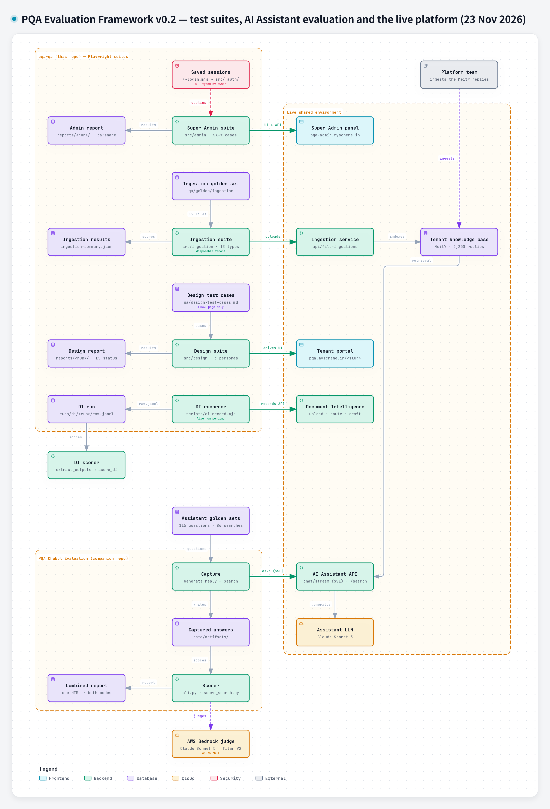
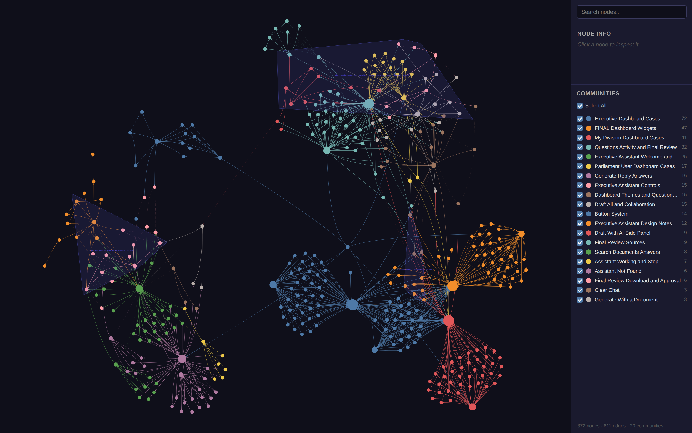

# pqa-eval-framework

**Version 0.2.0** · 23 Nov 2026 · [Changelog](#changelog)

Test and evaluation framework for the AI-Enabled Common Platform for Parliamentary Questions & Answers (PQA), a
Government of India platform on which each ministry is an isolated tenant and AI-drafted answers are grounded in
that tenant's knowledge base.

- **pqa-qa** (this repo): Playwright/TypeScript suites for the Super Admin panel, document ingestion, UI/UX design
  conformance and Document Intelligence.
- **PQA_Chabot_Evaluation** (companion repo): scores the tenant AI Assistant, in both Generate reply and Search
  mode, with RAGAS and LLM judges on AWS Bedrock.

## Architecture



- Interactive version: [docs/architecture/pqa-evaluation-framework.html](docs/architecture/pqa-evaluation-framework.html).
  Download it and open it in a browser to pan, zoom, search and read the cards (run order, results, rules).
- Source: [pqa-evaluation-framework.archify.json](docs/architecture/pqa-evaluation-framework.archify.json), made
  with [Archify](https://github.com/tt-a1i/archify). Edit it and run `archify finalize architecture` to update the
  diagram.

## What it covers

| Area | Where | Command | Input |
|---|---|---|---|
| Super Admin panel | `pqa-qa/src/admin` | `npm run qa:admin:login`, then `qa:admin`; `qa:share` for a shareable report | `SA-*` cases |
| Document ingestion | `pqa-qa/src/ingestion` | `qa:ingest:provision`, then `qa:ingest`, then `qa:ingest:retire` | Ingestion golden set: 89 files, 13 types |
| UI/UX design conformance | `pqa-qa/src/design` | `qa:design:login -- executive\|parliament\|division`, then `qa:design` | 260 `DS-*` cases from the shared design's FINAL page |
| Document Intelligence | `pqa-qa/scripts/di-record.mjs` | `qa:di:record -- parliament\|division`, then `extract_outputs.py` and `score_di.py` | Question-only PDFs |
| AI Assistant | PQA_Chabot_Evaluation | `capture_new_chatbot.py` / `capture_search.py`, then `cli.py` and `build_combined_report.py` | 115 questions, 86 searches |

Offline checks, with no portal access: `npm run typecheck` and `npm run qa:unit`. `npm run qa:pipeline` runs the
typecheck, the unit tests and the design suite.

The golden sets, test catalogues and the design snapshot live in the `PQA Builder/qa/` workspace, outside this repo;
`pqa-qa/.env.example` names the setting for each.

## Results so far

- **Super Admin:** 398 pass, 20 fail, 16 skip (final run, 22–26 Oct).
- **Ingestion golden run:** type accuracy 0.907, metadata accuracy 0.665, across 13 document types.
- **AI Assistant, Generate reply (115 questions):** overall 0.75 when the official reply is in the knowledge base,
  0.71 when it is not; faithfulness 0.99 and 0.98.
- **AI Assistant, Search (40 queries):** 18 of 25 queries with an ingested reply passed; the withheld reply was never
  returned (0 of 8).

## Design graph



A knowledge graph of the shared UI/UX design (snapshot of 20 Nov 2026), made with
[graphify](https://github.com/Graphify-Labs/graphify): 372 nodes, 811 edges and 20 communities from 18 design files.
The design suite's `DS-*` cases were written from this design.

- Interactive version: [docs/design-graph/graph.html](docs/design-graph/graph.html). Download it and open it in a
  browser; it loads vis-network from unpkg, so it needs an internet connection.
- Report: [docs/design-graph/GRAPH_REPORT.md](docs/design-graph/GRAPH_REPORT.md), with the communities and the most
  connected screens.

## Setup

```bash
cd pqa-qa
npm ci
npx playwright install chromium
cp .env.example .env
```

Fill in `.env` for the suites you run. Sign-in sessions are saved under `pqa-qa/src/.auth/`, which is git-ignored.

## Rules

- One Playwright process at a time, and one process per saved session.
- Writes only on a QA-owned disposable tenant: they stay off unless `PQA_*_ALLOW_WRITES=true`.
- Monsoon 2026 answer documents are never uploaded; they are the holdout.
- Design cases come only from the shared design's FINAL page.
- Judge cost is reported, never gated.

## Changelog

### 0.2.0 (23 Nov 2026)

- Added the UI/UX design conformance suite (`DS-*` cases, three personas) and the Document Intelligence recorder.
- The reports read design case ids and catalogue headings alongside the Super Admin ones.
- The AI Assistant is now scored by PQA_Chabot_Evaluation: RAGAS and MeitY judges on Claude Sonnet 5, for
  Generate reply and Search, in one combined report. This replaces the planned vendored Ragas scorer and MLflow.
- Architecture diagram updated to v0.2; design graph added.

### 0.1.0 (29 Oct 2026)

- Super Admin and ingestion suites, the assistant capture plan and the first architecture diagram.

## Original design: pqa-eval

The first design, a multi-tenant DeepEval framework with RAGAS metrics and a monitoring dashboard, is kept for
reference. Its code (`pqa-eval/`) is on the `feat/eval-framework` branch.

| Document | Contents |
|---|---|
| [Framework design](docs/superpowers/specs/2026-08-31-pqa-eval-framework-design.md) | Metric tiers, tenant isolation, datasets, 21 edge cases |
| [Dashboard design](docs/superpowers/specs/2026-08-31-pqa-dashboard-design.md) | Views, `ViewerScope` read-side isolation, alerts |
| [Implementation plan](docs/superpowers/plans/2026-08-31-pqa-eval-framework.md) | 34 tasks, test-first, with full code |
| [pqa-qa design](docs/superpowers/specs/2026-09-21-pqa-qa-design.md) | The Playwright suite's design |

## Note on the product spec

`docs/product.md` (the internal PQA product specification) is intentionally not committed. The design documents
restate every invariant they depend on, so they are readable without it.

## Licence

Not yet determined.
